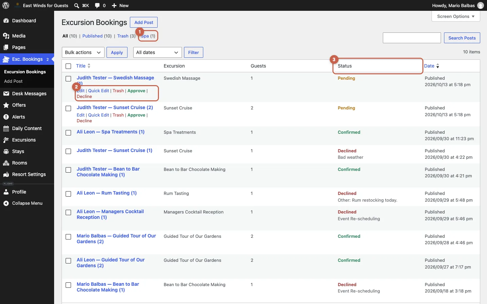

# East Winds — Docs for the guest app

Documentation for the East Winds Resort guest app (WordPress PWA), built by Hook + Ladder.

- **Manager Manual (beta):** how resort staff with the *Resort Manager* role run the app from wp-admin, in English and Saint Lucian Kwéyòl. Built with [Docsify](https://docsify.js.org): plain Markdown rendered in the browser, no build step.
- **Developer context:** [`dev/context.md`](dev/context.md) covers purpose, architecture, conventions and operations, for developers and AI agents.

## Structure

```
.
├── index.html          Docsify entry point and configuration (CDN scripts, language-switch plugin)
├── _navbar.md          Language switch (English / Kwéyòl)
├── en/                 Manual in English: one Markdown file per section
│   ├── _sidebar.md     Navigation for this language
│   ├── README.md       Welcome page (/en/)
│   └── bookings.md …   One file per section (/en/bookings …)
├── kw/                 Same files, in Kwéyòl (draft translation, pending native review)
├── assets/
│   ├── theme.css       Guest-app design tokens over Docsify's vue theme
│   └── img/            Screenshots and images, shared by both languages
├── dev/context.md      Project context for developers
├── CNAME               Custom domain for GitHub Pages (docs.eastwinds.com)
└── .nojekyll           Lets GitHub Pages serve files whose names start with "_"
```

## Run it locally

Docsify loads the Markdown files over HTTP, so opening `index.html` from the file system does not work. From the repository root:

```bash
python3 -m http.server 8000
```

Then open <http://localhost:8000>. Any static server works (`npx serve`, VS Code Live Server…).

## Publish

GitHub Pages serves `main` (*Settings → Pages → Deploy from a branch → `main` / root*). No build step is needed.

- **Domain:** `docs.eastwinds.com`, set by the `CNAME` file. DNS lives in Cloudflare: a `CNAME` record `docs → hookladder.github.io` in **DNS only** mode (grey cloud), so GitHub can issue the HTTPS certificate.
- **Not indexed:** `index.html` carries `<meta name="robots" content="noindex, nofollow">`. The site is still public to anyone with the link.
- **Branches:** `main` is the published version. Work happens on `new-version-incoming` and reaches `main` through a reviewed merge.

## Editing the manual

- **Change text:** edit the Markdown file of that section in `en/`, then the same file in `kw/`. Both languages keep the same file names, so the language switch lands on the same section.
- **Add a section:** create `en/<name>.md` and `kw/<name>.md`, then add one line to each `_sidebar.md`.
- **Screenshots:** put them in `assets/img/` (WebP, about 1440 px wide for admin screens) and reference them with a figure:

  ```html
  <figure><figcaption>Caption under the picture.</figcaption></figure>
  ```

  Add `class="phone"` to the `<figure>` for phone screenshots. Paths are relative to the repository root.
- **Callouts:** a paragraph starting with `!>` is a warning (red), and one starting with `?>` is a note (green). Start it with a bold title: `!> **Title** Text…`
- **Links between pages:** `[Stays](/en/stays)`, or to a heading: `[Change a picture](/en/media?id=change-a-picture)`.
- **Status pills:** `<span class="pill pending">pending</span>`, also `confirmed` and `declined`.

Write guest-facing examples in British English. Keep WordPress button and menu names in English in both languages, exactly as they appear on screen.
